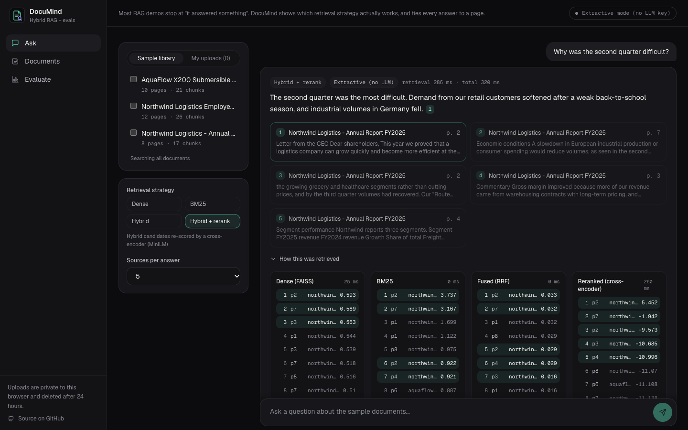
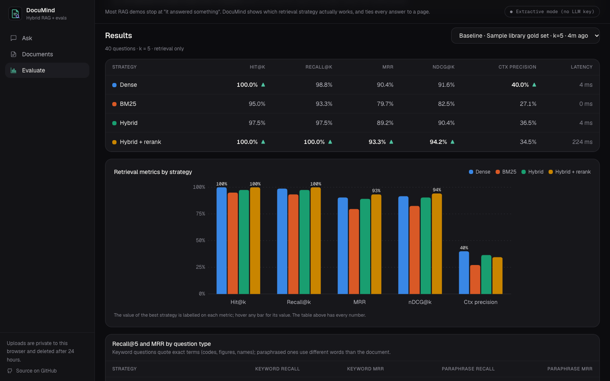
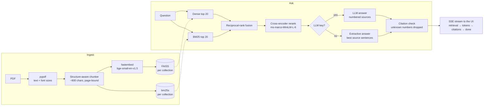
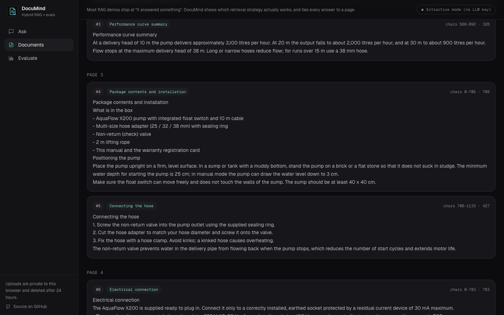
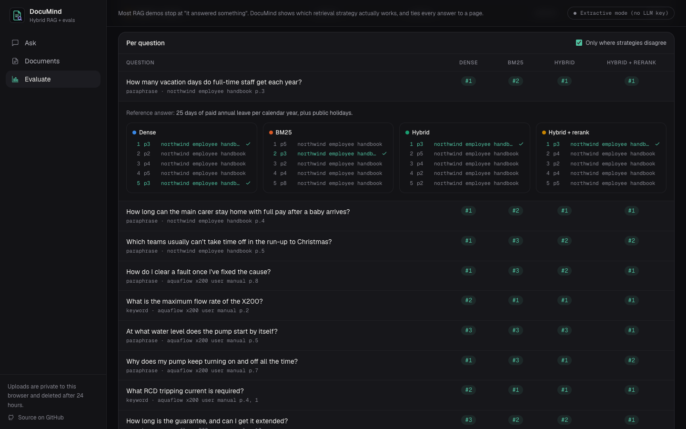

# DocuMind

**Hybrid RAG with built-in evaluation.** Ask questions about PDFs and get answers tied to the exact page, then see *which retrieval strategy actually works* on your documents: dense vectors, BM25, hybrid fusion and a cross-encoder reranker, measured side by side.

> Most RAG demos stop at "it answered something". DocuMind shows which retrieval strategy actually works on your documents and keeps every answer tied to a source.



- **Page-level citations.** Every sentence cites a numbered source; click one to see the passage, highlighted, and open the PDF at that page.
- **Retrieval you can see.** "How this was retrieved" shows what dense search, BM25, reciprocal-rank fusion and the reranker each returned, with scores and timings.
- **An evaluation page, not a vibe check.** Run a gold question set through every strategy and compare hit@k, recall@k, MRR, nDCG and context precision, overall and by question type, down to individual questions.
- **Works with no API key.** Retrieval, reranking, citations and retrieval metrics are always real. Without an LLM key, answers are *extractive* (the best-matching source sentences, labelled as such). Add a key and answers are LLM-written, plus LLM-judge metrics.
- **Pluggable LLM.** Claude, Gemini, Groq, OpenAI, Azure OpenAI or a local Ollama model.
- **Private uploads.** Drop in your own PDF (up to 5 MB / 40 pages). It's visible only to your browser and deleted after 24 hours.

## What the evaluation shows

The sample library is three fictional documents written for this project: an employee handbook, a pump user manual with spec tables and error codes, and an annual report. `samples/eval/gold.jsonl` has 40 questions with their gold pages: 21 *keyword* questions that quote exact terms ("What does error code E03 mean?") and 19 *paraphrased* ones that don't ("How long can the main carer stay home with full pay after a baby arrives?").

Baseline run, k = 5:

| Strategy | Hit@5 | Recall@5 | MRR | nDCG@5 | Mean latency |
|---|---|---|---|---|---|
| Dense (FAISS, bge-small) | 100.0% | 98.8% | 0.904 | 0.916 | 4 ms |
| BM25 | 95.0% | 93.3% | 0.797 | 0.825 | <1 ms |
| Hybrid (RRF) | 97.5% | 97.5% | 0.892 | 0.904 | 4 ms |
| **Hybrid + rerank** | **100.0%** | **100.0%** | **0.933** | **0.942** | 224 ms |

| Strategy | Keyword MRR | Paraphrase MRR | Paraphrase recall@5 |
|---|---|---|---|
| Dense | 0.929 | **0.877** | 100% |
| BM25 | 0.968 | 0.607 | 86% |
| Hybrid | **1.000** | 0.772 | 95% |
| Hybrid + rerank | **1.000** | 0.860 | 100% |

What that says:

- **BM25 beats dense on exact terms and collapses on paraphrases.** Codes, part numbers and figures are where keyword search shines (keyword MRR 0.968 vs 0.929), but when the question uses different words than the document, its MRR drops to 0.607.
- **Fusion gets the best of both on keywords** (MRR 1.000), but RRF can drag a good dense ranking down when BM25 is confidently wrong, as on paraphrases (0.772).
- **The cross-encoder repairs most of that**, giving the best recall and MRR overall, at about 50× the latency of the first stage (~0.2 s on a laptop CPU).
- **Not a clean sweep:** on paraphrases, plain dense search still has a slightly better MRR than hybrid + rerank. That's exactly the kind of result the eval page exists to surface; on your documents the ranking may differ.



## How it works



**Ingestion.** `pypdf` (BSD-licensed) extracts each page's text along with the font size of every text run, so headings can be recognised by being larger than the body text. Running headers and footers (lines that repeat on most pages) are dropped. The chunker splits each page into ~800-character chunks, preferring to break at a heading, then a paragraph end, a sentence end, a line break and finally a space. Chunks never cross a page, so every citation points at one page. Chunks in the same section overlap by ~120 characters (snapped to a sentence start) so a fact cut at a boundary still appears whole somewhere. "Semantic chunking" here means *structure-aware* boundaries, not embedding-based topic segmentation.



**Retrieval.** Each collection has an exact `IndexFlatIP` FAISS index over normalised 384-d embeddings and a `bm25s` index, persisted under `backend/data/indexes/`. Hybrid uses reciprocal-rank fusion (k = 60), which needs only ranks, so cosine and BM25 scores never have to be calibrated against each other. The reranker is a real cross-encoder (`Xenova/ms-marco-MiniLM-L-6-v2`, int8 ONNX).

**Embeddings.** [fastembed](https://github.com/qdrant/fastembed) runs sentence-transformers-compatible models through ONNX Runtime, with no PyTorch, which keeps the whole API around 300–450 MB of RAM and lets it run on a free 512 MB instance.

**Answering.** Retrieved passages go into the prompt as numbered `<source>` blocks, and the system prompt says they are data, not instructions. The model must cite with `[n]`, and the citation parser drops any number that wasn't provided. With no key, or if the provider fails before producing text, the **extractive** fallback scores every source sentence (and table row, labelled with its header) with the same cross-encoder and returns the best few with their citations. It can't say anything the documents don't.

**Evaluation.**

| Metric | Meaning |
|---|---|
| Hit@k | a gold page appears in the top k |
| Recall@k | share of the question's gold pages found in the top k |
| MRR | 1 / rank of the first gold-page chunk |
| nDCG@k | rank-weighted gain; each gold page counts once |
| Context precision | share of the top-k chunks that come from a gold page |
| Faithfulness *(LLM judge)* | share of the answer's claims supported by the retrieved text |
| Answer relevance *(LLM judge)* | how directly the answer addresses the question (1–5, scaled to 0–1) |
| Supported share *(keyless proxy)* | answer sentences closely matched (cosine ≥ 0.8) by a retrieved sentence |
| Q–A similarity *(keyless proxy)* | embedding similarity of question and answer |

Answer metrics are optional per run and capped at the first 12 questions to keep LLM usage small. You can build your own question sets in the UI (question, document, gold pages) against the sample library or your uploads.



## Run it locally

You need [uv](https://docs.astral.sh/uv/) and Node 22.

```bash
# API on :8002 (first start downloads ~100 MB of ONNX models and indexes the sample PDFs)
cd backend
uv sync
uv run uvicorn app.main:app --port 8002

# UI on :4300
cd frontend
npm install
npx ng serve --port 4300
```

Then open http://localhost:4300. The API allows `localhost:4200` and `localhost:4300` by default.

For LLM-written answers, copy `backend/.env.example` to `backend/.env` and set one key. `GROQ_API_KEY` and `GOOGLE_API_KEY` both have free tiers. The header badge switches from "Extractive mode" to the provider and model.

**With Docker:** `docker compose up --build`, then open http://localhost:4300.

**Tests:**

```bash
cd backend
uv run pytest -q      # chunking, RRF, metrics, retrieval quality on the gold set, API, workspaces, evals
uv run ruff check app tests ../samples
```

The retrieval test asserts that hybrid + rerank recall@5 is at least as good as dense and as BM25 on the gold set, and prints the comparison table (`pytest -s`).

**Rebuilding the sample PDFs:** `cd backend && uv run python ../samples/build_pdfs.py`. Each `---page---` marker in `samples/src/*.md` starts a new page, so the gold page numbers stay stable.

## Deploy

**API → Render** (free plan). Create a Blueprint from `render.yaml`. The build installs dependencies, downloads the models and runs `python -m app.prebuild`, which indexes the sample library and runs the baseline evaluation, so a cold start only loads files. Set `DOCUMIND_CORS_ORIGINS` to your frontend URL, and optionally `GROQ_API_KEY` or `GOOGLE_API_KEY`.

**UI → Vercel.** Import the repo with **Root Directory** `frontend`; `vercel.json` handles the rest. Set the environment variable `DOCUMIND_API_URL` to the Render URL. The build writes it into `public/env.js`, so the same bundle can point at any backend.

Free Render instances sleep when idle; the first request after a while takes ~30–60 s while the API wakes up.

## Configuration

All settings use the `DOCUMIND_` prefix (see `backend/app/config.py`). LLM keys use their usual names.

| Variable | Default | |
|---|---|---|
| `ANTHROPIC_API_KEY` / `GOOGLE_API_KEY` / `GROQ_API_KEY` / `OPENAI_API_KEY` | – | First one set wins, in this order |
| `AZURE_OPENAI_API_KEY`, `AZURE_OPENAI_ENDPOINT`, `AZURE_OPENAI_DEPLOYMENT` | – | Azure OpenAI |
| `DOCUMIND_LLM_PROVIDER` | auto | `anthropic`, `google`, `groq`, `openai`, `azure`, `ollama` or `extractive` |
| `DOCUMIND_LLM_MODEL` | per provider | e.g. `claude-haiku-5-5`, `gemini-flash-lite-latest`, `llama-3.3-70b-versatile` |
| `DOCUMIND_CORS_ORIGINS` | localhost:4200 and :4300 | JSON list |
| `DOCUMIND_MODEL_THREADS` | ONNX default | `1` on small instances |
| `DOCUMIND_MAX_UPLOAD_MB`, `DOCUMIND_MAX_PAGES`, `DOCUMIND_MAX_DOCS_PER_WORKSPACE`, `DOCUMIND_WORKSPACE_TTL_HOURS` | 5, 40, 5, 24 | Upload limits |
| `DOCUMIND_CHAT_PER_MINUTE`, `DOCUMIND_UPLOADS_PER_HOUR`, `DOCUMIND_EVAL_RUNS_PER_HOUR` | 20, 5, 3 | Per-IP rate limits |

## API

Interactive docs at `/docs`.

| Endpoint | |
|---|---|
| `POST /chat` | `{question, scope, doc_ids?, strategy, top_k}` → SSE: `retrieval`, `token`*, `citations`, `done` |
| `POST /retrieve` | Retrieval only: every stage's ranking, scores and timings |
| `GET /documents`, `GET /documents/{id}`, `GET /documents/{id}/chunks`, `GET /documents/{id}/file` | Library + your uploads |
| `POST /documents`, `DELETE /documents/{id}` | Upload (202 + job id) / delete your upload |
| `GET /ingest/{job}/events` | SSE: parse → chunk → embed → index progress |
| `GET/POST /eval/datasets`, `POST /eval/datasets/{id}/items` | Question sets |
| `POST /eval/runs`, `GET /eval/runs/{id}/events`, `GET /eval/runs`, `GET /eval/runs/{id}` | Run, stream progress, list, results |
| `GET /llm/provider`, `GET /strategies`, `GET /health` | |

Uploads, custom question sets and your runs are scoped by an `X-Workspace` header: a random id the browser generates and keeps. There are no accounts. The sample library is read-only.

## Safety in the public demo

- **Uploads:** checked as PDF by magic bytes, with size and page limits; encrypted and image-only PDFs are rejected with a clear message. Nothing is executed or shelled out.
- **Isolation and expiry:** each workspace's documents live in their own collection and index, and are deleted after 24 h, along with custom eval data.
- **Rate limits:** per-IP sliding windows for chat, uploads and eval runs.
- **Prompt injection:** sources are fenced and declared as data, and citations are validated against the sources actually provided.
- **Rendering:** the UI renders answers as text plus citation chips; model output never goes through `innerHTML` unescaped.

## Project layout

```
backend/
  app/
    ingest/      pdf.py (pypdf + font sizes), chunker.py, embed.py (fastembed), indexer.py (FAISS + bm25s), pipeline.py
    retrieval/   dense.py, sparse.py, fusion.py (RRF), rerank.py, strategies.py, routes.py
    answer/      prompt.py, llm.py (providers), extractive.py, citations.py, service.py, routes.py (SSE /chat)
    eval/        metrics.py, judge.py, runner.py, routes.py
    documents/   routes.py (upload, list, chunks, file, ingestion SSE)
    workspaces.py, ratelimit.py, sse.py, prebuild.py, main.py
  tests/
frontend/        Angular 22 (standalone, zoneless, signals) + Tailwind v4
samples/         src/*.md → build_pdfs.py → *.pdf, eval/gold.jsonl
```

## License

MIT © 2026 Himanshu Chelani
